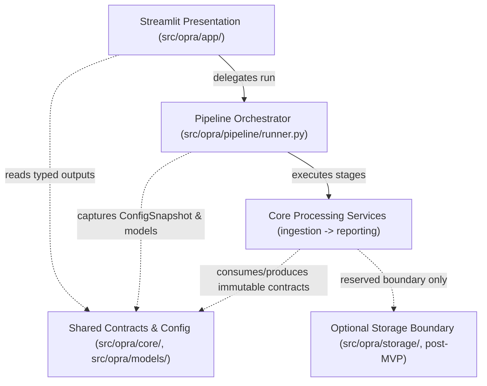

# OPRA.AI — Operational Performance and Recommendation Analytics

**Status:** Active development — v0.1.0. The repository contains a headless CSV-to-report analytics pipeline and a Streamlit interface. Package 1 implementation is present; owner acceptance is still required before work proceeds to the next package.

## 1. Overview

**OPRA.AI** is a deterministic operational analytics and recommendation platform. It is designed to turn structured workshop records (work orders, turnaround times, billing, job statuses) into standardized KPIs, evidence-backed findings, prioritized recommendations, and reproducible JSON and Markdown reports.

**Problem addressed.** Service businesses often track work in spreadsheets or fragmented logs without consistent validation, period comparisons, sample-size context, or reproducible recommendations. OPRA.AI aims to close that gap with a stateless, deterministic Python engine that is decoupled from its Streamlit user interface.

**Focus and direction.** The initial focus is **automotive service businesses**. The architecture is intended to scale to other industries later; any industry adapters require separate approval and are not part of the MVP.

## 2. Objectives (MVP)

* Process uploaded UTF-8 CSV data statelessly and in memory, within configured upload and row limits.
* Produce deterministic KPI outputs with explicit `None` / `N/A` / `0` semantics and `Decimal` precision.
* Report deterministic findings with sample-size and evidence-sufficiency context, plus fixed recommendations and data caveats.
* Export reproducible JSON and Markdown reports carrying execution metadata.
* Keep the Streamlit layer thin, with all analytical logic in headless, independently testable modules.

The authoritative requirement list is in [docs/PRODUCT_REQUIREMENTS.md](docs/PRODUCT_REQUIREMENTS.md).

## 3. Processing Pipeline

```text
Ingestion → Validation → Processing → Analytics → Intelligence → Recommendations → Reporting
```

## 4. Architecture

OPRA.AI is a modular Python monolith (`src/opra/`). The presentation layer delegates to a pipeline orchestrator, which runs the processing services in order. Shared contracts and configuration are used by every layer; they are not a stage after reporting.



### Module responsibilities

Packages under `src/opra/` and their current responsibilities are listed below. Business rules and acceptance criteria remain governed by the approved specifications and the [implementation roadmap](docs/IMPLEMENTATION_ROADMAP.md).

| Package | Intended responsibility |
| :--- | :--- |
| `app/` | Streamlit upload and parameter collection, pipeline invocation, result display, and downloads; no KPI calculations or CSV validation rules. |
| `pipeline/` | Captures a `ConfigSnapshot`, runs the stages in order, and assembles the final immutable report contract. |
| `core/` | Validated configuration snapshots and domain exceptions. Environment loading and a dedicated logging service are not implemented. |
| `models/` | Immutable typed contracts for records, periods, KPIs, comparisons, findings, recommendations, limitations, and reports. |
| `ingestion/` | UTF-8 CSV structure and field validation, upload/row bounds, duplicate resolution, privacy-safe quarantine diagnostics, and record counters. |
| `validation/` | Package boundary reserved; current CSV record validation is implemented in `ingestion/csv_loader.py`. |
| `processing/` | Deterministic intake, completion, and turnaround cohort assignment. Maturity eligibility is applied by analytics. |
| `analytics/` | Decimal KPI-01–KPI-07 calculations, maturity eligibility, negative-duration handling, and period comparisons. |
| `intelligence/` | Deterministic threshold findings with sample-size and evidence-sufficiency tiers. Tiers are not statistical confidence claims. |
| `recommendations/` | Fixed recommendations mapped to approved findings. |
| `reporting/` | Deterministic integrated JSON and Markdown exports under the approved report contract. |
| `storage/` | Reserved post-MVP persistence boundary; not part of the stateless MVP. |

Streamlit may only be imported inside `src/opra/app/` (enforced by `tests/app/test_architecture_boundaries.py`).

## 5. Technology Stack

| Area | Choice |
| :--- | :--- |
| Language | Python `>=3.11` |
| UI | Streamlit (`>=1.40,<2.0`), presentation layer only |
| Dependency management | `uv` — `pyproject.toml` (source of truth) and `uv.lock` (lockfile) |
| Build backend | Hatchling |
| Testing | `pytest`, `pytest-cov` (80% minimum coverage) |
| Lint / format | Ruff (line length 100) |
| Type checking | `mypy` in strict mode |
| CI | GitHub Actions (`.github/workflows/ci.yml`) |

## 6. Repository Structure

```text
.
├── .env.example                 # Non-secret configuration template
├── .github/workflows/ci.yml     # CI workflow
├── .gitignore
├── AGENTS.md                    # Instructions for AI coding agents
├── LICENSE
├── README.md
├── pyproject.toml
├── uv.lock
├── docs/                        # Engineering documentation (see section 10)
├── src/opra/
│   ├── __init__.py              # Package version
│   ├── app/                     # Streamlit presentation (main.py, pages/, components/)
│   ├── analytics/
│   ├── core/                    # Configuration and domain exceptions
│   ├── ingestion/
│   ├── intelligence/
│   ├── models/
│   ├── pipeline/
│   ├── processing/
│   ├── recommendations/
│   ├── reporting/
│   ├── storage/
│   └── validation/
└── tests/
    ├── conftest.py              # Shared fixtures
    ├── app/                     # Architecture-boundary tests
    ├── integration/             # Reserved for end-to-end integration tests
    ├── sample_data/             # Test sample-data package
    └── unit/                    # Unit and contract tests
```

## 7. Setup and Usage

### Prerequisites

Python `>=3.11` and [`uv`](https://docs.astral.sh/uv/).

### Install dependencies

```bash
uv sync --locked --extra dev
```

The development tools (`pytest`, `pytest-cov`, `ruff`, `mypy`) are declared as the `dev` extra, so the `--extra dev` flag is required to install them.

### Environment configuration

`.env.example` lists the non-secret configuration keys and their defaults. Copy it to `.env` for local overrides; never commit `.env`.

```bash
cp .env.example .env
```

> `src/opra/core/config.py` defines validated configuration objects but does not read environment variables or `.env`; these variables are not read by the application.

### Run the application

```bash
uv run streamlit run src/opra/app/main.py
```

The Streamlit interface accepts an automotive CSV, period and snapshot inputs, then displays current KPIs, optional period comparisons, findings, recommendations, ingestion counts, and limitations. It also provides JSON and Markdown downloads. The interface delegates calculations to `src/opra/pipeline/runner.py`.

### Quality checks

Run all four before submitting any change; CI runs the same commands.

```bash
uv run ruff check .
uv run ruff format --check .
uv run mypy src/opra
uv run pytest --cov=opra --cov-report=term-missing --cov-fail-under=80
```

## 8. Data Governance Summary

* Processing is stateless and in memory; there is no database, disk retention of uploads, or cross-session dataset cache.
* Uploaded CSVs are treated as untrusted input and are bounded by `max_upload_bytes` (default `10 * 1024 * 1024`) and `max_rows` (default `100_000`).
* Raw rows and customer/vehicle identifiers must never be logged; tests and benchmarks use synthetic data only.

Full rules: [docs/SECURITY_AND_DATA_GOVERNANCE.md](docs/SECURITY_AND_DATA_GOVERNANCE.md).

## 9. Implementation Status

| Area | Status |
| :--- | :--- |
| Repository scaffold, package layout, tooling, and CI workflow | Present |
| Core configuration and exceptions | Implemented; environment and `.env` loading are not implemented |
| Canonical record and period models | Implemented with immutable, UTC-normalized contracts |
| CSV ingestion and validation | Implemented for the approved [OPRA-INGEST-001 v1.2.0](docs/specifications/OPRA-INGEST-001.md) contract, including duplicate handling, quarantine, and counters |
| Processing cohorts | Implemented for [OPRA-PROCESSING-001](docs/specifications/OPRA-PROCESSING-001.md) |
| KPI calculations and comparisons | Implemented against [OPRA-ANALYTICS-001](docs/specifications/OPRA-ANALYTICS-001.md) |
| Findings and recommendations | Implemented against [OPRA-INTELLIGENCE-001](docs/specifications/OPRA-INTELLIGENCE-001.md); evidence tiers describe data sufficiency, not statistical confidence |
| Integrated JSON and Markdown reports | Implemented against [OPRA-REPORT-001 v1.1.0](docs/specifications/OPRA-REPORT-001.md) |
| Pipeline and Streamlit interface | Headless pipeline and upload/results/download interface are present; the UI remains a presentation layer |
| Package 1 acceptance | Stage 4A/4B reconciliation and verification are documented; formal owner acceptance is pending |
| `tests/integration/` | No tests are currently located here; pipeline behavior is covered by unit tests |
| Performance benchmark (`scripts/benchmark_pipeline.py`) | Planned; the script is not present |
| Production readiness | Not claimed |

The implementation sequence and remaining release work are tracked in the [implementation roadmap](docs/IMPLEMENTATION_ROADMAP.md). Open business decisions remain documented in the authoritative specifications and decision records.

## 10. Documentation

| Document | Purpose |
| :--- | :--- |
| [AGENTS.md](AGENTS.md) | Engineering instructions for AI coding agents |
| [docs/PROJECT_FOUNDATION.md](docs/PROJECT_FOUNDATION.md) | Vision, scope, MVP boundaries, constraints |
| [docs/PRODUCT_REQUIREMENTS.md](docs/PRODUCT_REQUIREMENTS.md) | Testable functional and non-functional requirements |
| [docs/TECHNICAL_DESIGN.md](docs/TECHNICAL_DESIGN.md) | Architecture, layers, and module responsibilities |
| [docs/DATA_AND_ANALYTICS.md](docs/DATA_AND_ANALYTICS.md) | Data semantics, duplicates, periods, analytical contracts |
| [docs/PYTHON_ENGINEERING_STANDARDS.md](docs/PYTHON_ENGINEERING_STANDARDS.md) | Typing, immutability, configuration, tooling standards |
| [docs/TESTING_AND_QUALITY.md](docs/TESTING_AND_QUALITY.md) | Test strategy and mandatory quality gates |
| [docs/SECURITY_AND_DATA_GOVERNANCE.md](docs/SECURITY_AND_DATA_GOVERNANCE.md) | Upload controls, privacy, session isolation, secrets |
| [docs/DEPLOYMENT_AND_OPERATIONS.md](docs/DEPLOYMENT_AND_OPERATIONS.md) | Runtime setup, environment stages, release gates |
| [docs/IMPLEMENTATION_MASTER_PLAN.md](docs/IMPLEMENTATION_MASTER_PLAN.md) | Approved implementation packages and execution controls |
| [docs/IMPLEMENTATION_ROADMAP.md](docs/IMPLEMENTATION_ROADMAP.md) | Dependency-ordered stages and Package 1 boundaries |
| [docs/tasks/OPRA-MODELS-001.md](docs/tasks/OPRA-MODELS-001.md) | Stage 2A configuration implementation and remaining model decisions |
| [docs/specifications/OPRA-INGEST-001.md](docs/specifications/OPRA-INGEST-001.md) | Approved v1.2.0 CSV ingestion contract for Stage 3B implementation |
| [docs/specifications/OPRA-PROCESSING-001.md](docs/specifications/OPRA-PROCESSING-001.md) | Approved automotive cohort assignment rules |
| [docs/specifications/OPRA-ANALYTICS-001.md](docs/specifications/OPRA-ANALYTICS-001.md) | Approved KPI and period comparison contract |
| [docs/specifications/OPRA-INTELLIGENCE-001.md](docs/specifications/OPRA-INTELLIGENCE-001.md) | Approved finding, evidence, and recommendation rules |
| [docs/specifications/OPRA-REPORT-001.md](docs/specifications/OPRA-REPORT-001.md) | Generic and integrated report schemas and serialization |
| [docs/reports/OPRA-ANALYTICS-V1-APPROVAL-001.md](docs/reports/OPRA-ANALYTICS-V1-APPROVAL-001.md) | Owner approval for the analytics v1 specifications |
| [docs/reports/OPRA-PACKAGE1-RECONCILIATION-001.md](docs/reports/OPRA-PACKAGE1-RECONCILIATION-001.md) | Package 1 verification and owner-acceptance handover |

## 11. License

Released under the MIT License. See [LICENSE](LICENSE).
