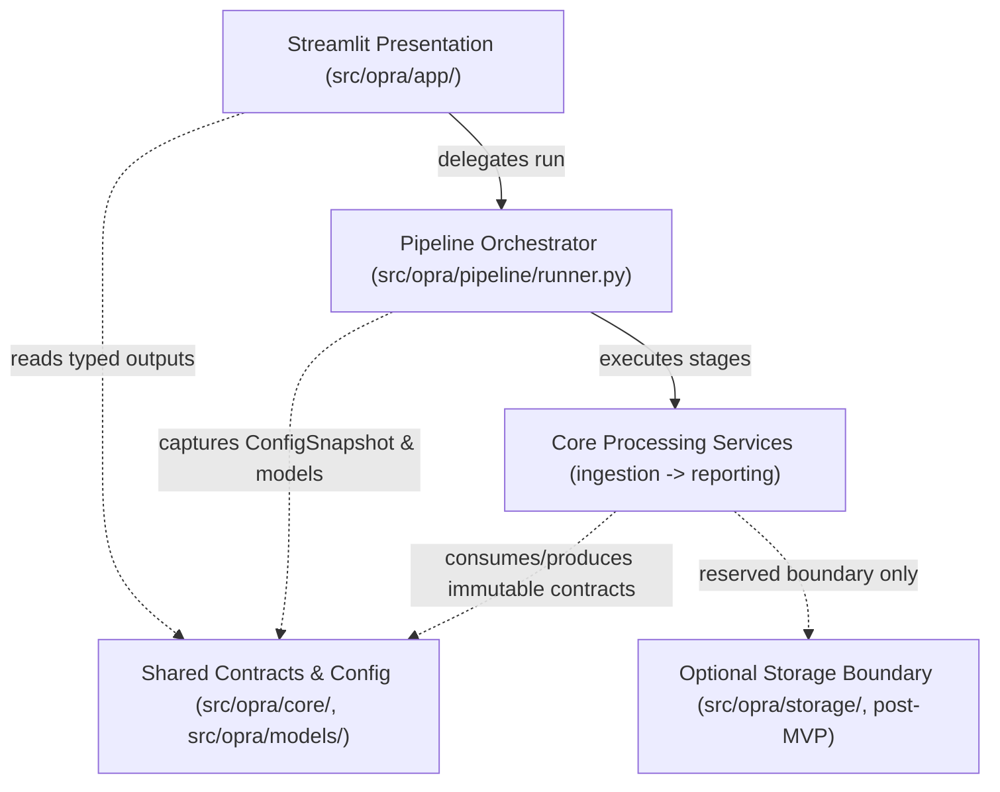

# OPRA.AI — Operational Performance and Recommendation Analytics

**Status:** Under active development — v0.1.0 foundation scaffold. The analytics pipeline is **not implemented yet** (see [Implementation Status](#9-implementation-status)).

## 1. Overview

**OPRA.AI** is a deterministic operational analytics and recommendation platform. It is designed to turn structured workshop records (work orders, turnaround times, billing, job statuses) into standardized KPIs, evidence-backed findings, prioritized recommendations, and reproducible JSON and Markdown reports.

**Problem addressed.** Service businesses often track work in spreadsheets or fragmented logs without consistent validation, period comparisons, sample-size context, or reproducible recommendations. OPRA.AI aims to close that gap with a stateless, deterministic Python engine that is decoupled from its Streamlit user interface.

**Focus and direction.** The initial focus is **automotive service businesses**. The architecture is intended to scale to other industries later; any industry adapters require separate approval and are not part of the MVP.

## 2. Objectives (MVP)

* Process uploaded UTF-8 CSV data statelessly and in memory, within configured upload and row limits.
* Produce deterministic KPI outputs with explicit `None` / `N/A` / `0` semantics and `Decimal` precision.
* Report findings with sample-size and confidence context, and prioritized recommendations that surface data caveats.
* Export reproducible JSON and Markdown reports carrying execution metadata.
* Keep the Streamlit layer thin, with all analytical logic in headless, independently testable modules.

The authoritative requirement list is in [docs/PRODUCT_REQUIREMENTS.md](docs/PRODUCT_REQUIREMENTS.md).

## 3. Processing Pipeline

```text
Ingestion → Validation → Processing → Analytics → Intelligence → Recommendations → Reporting
```

## 4. Architecture

OPRA.AI is a modular Python monolith (`src/opra/`). The presentation layer delegates to a pipeline orchestrator, which runs the processing services in order. Shared contracts and configuration are used by every layer; they are not a stage after reporting.



### Module responsibilities

Packages under `src/opra/` and their intended roles (from [docs/TECHNICAL_DESIGN.md](docs/TECHNICAL_DESIGN.md)). Apart from `app/main.py` and the Stage 2A configuration and exception modules in `core/`, the packages are currently placeholders.

| Package | Intended responsibility |
| :--- | :--- |
| `app/` | Thin Streamlit shell, pages, and display components. Rendering and session-scoped state only; no KPI math or validation rules. |
| `pipeline/` | Captures a `ConfigSnapshot`, runs the stages in order, and assembles the final immutable report contract. |
| `core/` | Centralized configuration, fail-fast validation, exception hierarchy, and PII-safe logging. |
| `models/` | Deeply immutable typed contracts for records, periods, analytics outputs, and intelligence/recommendations. |
| `ingestion/` | UTF-8 CSV loading with upload-size and row-count checks. |
| `validation/` | Structure/field validation and `job_id` duplicate handling, including quarantine of conflicting rows. |
| `processing/` | Domain normalization, reporting periods, and maturity/cohort handling. |
| `analytics/` | Deterministic `Decimal` KPI calculations and period-over-period comparisons. |
| `intelligence/` | Deterministic findings with sample-size and confidence context. |
| `recommendations/` | Prioritized recommendations linked to findings and data caveats. |
| `reporting/` | Reproducible JSON and Markdown exports with execution metadata. |
| `storage/` | Reserved post-MVP persistence boundary; not part of the stateless MVP. |

Streamlit may only be imported inside `src/opra/app/` (enforced by `tests/app/test_architecture_boundaries.py`).

## 5. Technology Stack

| Area | Choice |
| :--- | :--- |
| Language | Python `>=3.11` |
| UI | Streamlit (`>=1.40,<2.0`), presentation layer only |
| Dependency management | `uv` — `pyproject.toml` (source of truth) and `uv.lock` (lockfile) |
| Build backend | Hatchling |
| Testing | `pytest`, `pytest-cov` (80% minimum coverage) |
| Lint / format | Ruff (line length 100) |
| Type checking | `mypy` in strict mode |
| CI | GitHub Actions (`.github/workflows/ci.yml`) |

## 6. Repository Structure

```text
.
├── .env.example                 # Non-secret configuration template
├── .github/workflows/ci.yml     # CI workflow
├── .gitignore
├── AGENTS.md                    # Instructions for AI coding agents
├── LICENSE
├── README.md
├── pyproject.toml
├── uv.lock
├── docs/                        # Engineering documentation (see section 10)
├── src/opra/
│   ├── __init__.py              # Package version
│   ├── app/                     # Streamlit presentation (main.py, pages/, components/)
│   ├── analytics/
│   ├── core/                    # Configuration and domain exceptions
│   ├── ingestion/
│   ├── intelligence/
│   ├── models/
│   ├── pipeline/
│   ├── processing/
│   ├── recommendations/
│   ├── reporting/
│   ├── storage/
│   └── validation/
└── tests/
    ├── conftest.py              # Shared fixtures
    ├── app/                     # Architecture-boundary tests
    ├── integration/             # Placeholder (no tests yet)
    ├── sample_data/             # Placeholder (no datasets yet)
    └── unit/                    # Core configuration tests
```

## 7. Setup and Usage

### Prerequisites

Python `>=3.11` and [`uv`](https://docs.astral.sh/uv/).

### Install dependencies

```bash
uv sync --locked --extra dev
```

The development tools (`pytest`, `pytest-cov`, `ruff`, `mypy`) are declared as the `dev` extra, so the `--extra dev` flag is required to install them.

### Environment configuration

`.env.example` lists the non-secret configuration keys and their defaults. Copy it to `.env` for local overrides; never commit `.env`.

```bash
cp .env.example .env
```

> `src/opra/core/config.py` defines validated configuration objects but does not read environment variables or `.env`; these variables are not read by the application.

### Run the application

```bash
uv run streamlit run src/opra/app/main.py
```

The app currently renders only a foundation status page.

### Quality checks

Run all four before submitting any change; CI runs the same commands.

```bash
uv run ruff check .
uv run ruff format --check .
uv run mypy src/opra
uv run pytest --cov=opra --cov-report=term-missing --cov-fail-under=80
```

## 8. Data Governance Summary

* Processing is stateless and in memory; there is no database, disk retention of uploads, or cross-session dataset cache.
* Uploaded CSVs are treated as untrusted input and are bounded by `max_upload_bytes` (default `10 * 1024 * 1024`) and `max_rows` (default `100_000`).
* Raw rows and customer/vehicle identifiers must never be logged; tests and benchmarks use synthetic data only.

Full rules: [docs/SECURITY_AND_DATA_GOVERNANCE.md](docs/SECURITY_AND_DATA_GOVERNANCE.md).

## 9. Implementation Status

| Area | Status |
| :--- | :--- |
| Repository scaffold, package layout, tooling, and CI workflow | Present |
| Streamlit shell (`src/opra/app/main.py`) | Foundation status page only |
| Architecture-boundary tests (package importability, Streamlit isolation) | Present |
| Core configuration (`OpraConfig`, `ConfigSnapshot`) and `ConfigurationError` | Implemented (Stage 2A); no environment loading |
| Domain models (`records`, `periods`, `analytics`, `intelligence`) | Not implemented — blocked on unresolved decisions in [docs/tasks/OPRA-MODELS-001.md](docs/tasks/OPRA-MODELS-001.md) |
| Ingestion, validation, processing, analytics, intelligence, recommendations, reporting, pipeline | Not implemented |
| Performance benchmark (`scripts/benchmark_pipeline.py`, 50,000 rows in under 5.0 s) | Planned; script does not exist yet |
| Production readiness | Not claimed |

Open design decisions (CSV schema, KPI catalogue, confidence rules, rounding modes) are tracked in the "Unresolved Decisions" sections of the documents below.

## 10. Documentation

| Document | Purpose |
| :--- | :--- |
| [AGENTS.md](AGENTS.md) | Engineering instructions for AI coding agents |
| [docs/PROJECT_FOUNDATION.md](docs/PROJECT_FOUNDATION.md) | Vision, scope, MVP boundaries, constraints |
| [docs/PRODUCT_REQUIREMENTS.md](docs/PRODUCT_REQUIREMENTS.md) | Testable functional and non-functional requirements |
| [docs/TECHNICAL_DESIGN.md](docs/TECHNICAL_DESIGN.md) | Architecture, layers, and module responsibilities |
| [docs/DATA_AND_ANALYTICS.md](docs/DATA_AND_ANALYTICS.md) | Data semantics, duplicates, periods, analytical contracts |
| [docs/PYTHON_ENGINEERING_STANDARDS.md](docs/PYTHON_ENGINEERING_STANDARDS.md) | Typing, immutability, configuration, tooling standards |
| [docs/TESTING_AND_QUALITY.md](docs/TESTING_AND_QUALITY.md) | Test strategy and mandatory quality gates |
| [docs/SECURITY_AND_DATA_GOVERNANCE.md](docs/SECURITY_AND_DATA_GOVERNANCE.md) | Upload controls, privacy, session isolation, secrets |
| [docs/DEPLOYMENT_AND_OPERATIONS.md](docs/DEPLOYMENT_AND_OPERATIONS.md) | Runtime setup, environment stages, release gates |
| [docs/tasks/OPRA-MODELS-001.md](docs/tasks/OPRA-MODELS-001.md) | Stage 2A configuration implementation and remaining model decisions |
| [docs/specifications/OPRA-INGEST-001.md](docs/specifications/OPRA-INGEST-001.md) | Proposed data ingestion contract; awaiting owner approval before implementation |

## 11. License

Released under the MIT License. See [LICENSE](LICENSE).
