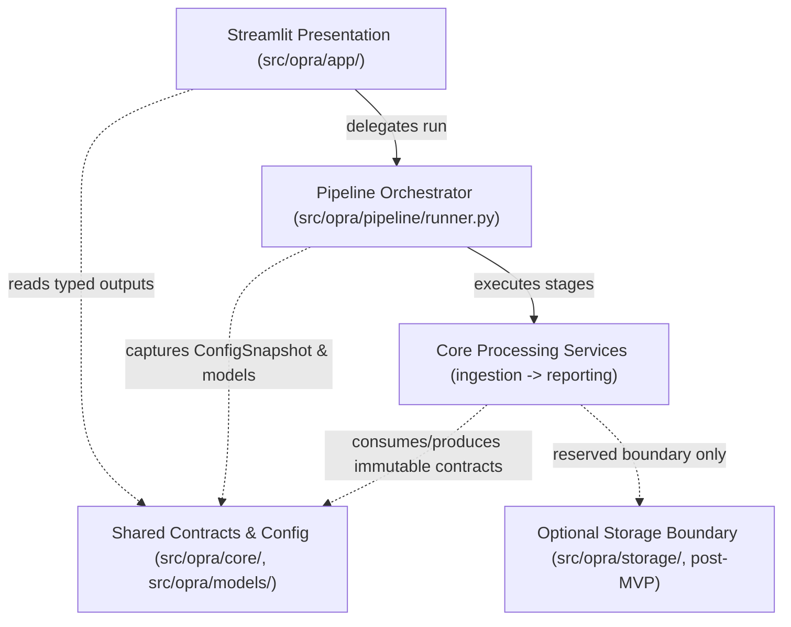

# OPRA.AI — Operational Performance and Recommendation Analytics

**Status:** Under Active Development (v0.1.0 MVP Foundation)

**OPRA.AI** is a deterministic operational analytics platform initially focused on **automotive service businesses**. It transforms raw workshop operational data into standardized KPIs, evidence-backed operational findings, prioritized recommendations, and reproducible JSON and Markdown reports.

## 1. Purpose and Scope

Service businesses often track work orders, cycle times, billing, and job statuses across spreadsheets or fragmented logs without consistent validation, cohort/maturity rules, sample-size context, or repeatable recommendations. OPRA.AI addresses this by running a stateless, deterministic Python pipeline over uploaded CSV records and exporting structured JSON and Markdown reports.

## 2. Architecture Overview

OPRA.AI is a modular Python monolith (`src/opra/`) that separates the Streamlit presentation layer from pipeline orchestration, sequential processing services, and shared immutable contracts.

